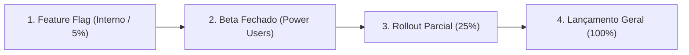

# 📦 Feature Brief & Rollout Strategy: [Nome da Feature]
> **Produto Ativo:** [Nome do Produto Atual] | **Métrica-Alvo:** [Ativação / Retenção / Monetização]
> **PM Lead:** Kevin Augusto Vieira | **Framework:** Product-Led Growth & Lean Feature Discovery

---

## 1. Problema & Hipótese de Valor
- **A Dor Real do Usuário:** [Descrição da dor comportamental, não da funcionalidade]
- **Origem da Demanda:** [Sinal de produto: telemetria, pedidos recorrentes, atrito no fluxo atual]
- **Hipótese de Impacto:**
  > *"Acreditamos que implementar [funcionalidade] resolverá [dor do usuário], aumentando a métrica [métrica-alvo] de [X%] para [Y%] em [Z semanas]."*

---

## 2. Anti-Feature Creep & Escopo Negativo (O que NÃO vamos construir)
- **V1 (MVP da Feature):** [Apenas o núcleo estritamente indispensável para gerar valor]
- **Escopo Negativo Explícito (Out of Scope):**
  - ❌ [Recurso secundário que adiciona complexidade]
  - ❌ [Customizações avançadas que podem esperar pela V2]
  - ❌ [Integrações pesadas antes de validar a adesão]

---

## 3. Validação Pré-Código (Discovery Enxuto)
- **Tipo de Teste Selecionado:** [Fake Door Test / Protótipo Figma com 5 clientes / Beta Fechado via convite]
- **Sinal de Validação:** [Ex: Se ≥ 20% dos usuários expostos clicarem no botão de intenção de uso]
- **Resultados do Teste de Intenção:** [Dados coletados antes de gastar horas de desenvolvimento]

---

## 4. Estratégia de Rollout & Adoção In-App

- **Gatilho de Descoberta In-App:** [Banner contextual, badge de novidade, tooltip no momento de necessidade]
- **Métricas de Adoção & Sucesso:**
  - *Descoberta:* % de usuários que visualizaram a novidade
  - *Experimentação:* % de usuários que completaram a primeira ação
  - *Retenção da Feature:* % de usuários que repetem o uso no D7 e D30
