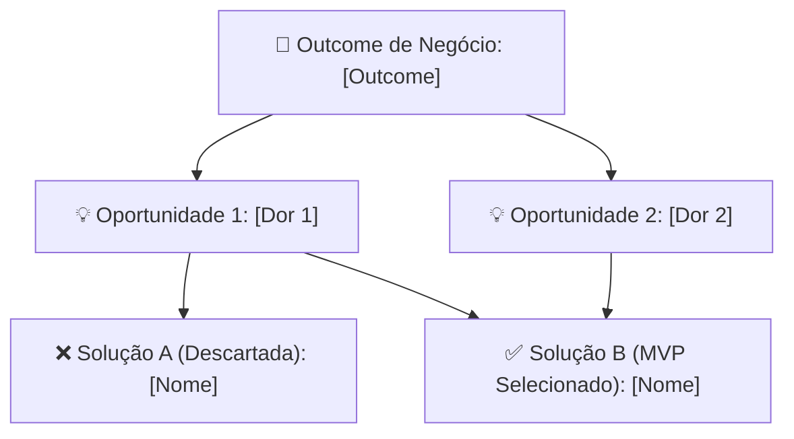

# 🚀 GTM Launch Brief & Hypothesis Canvas: [Nome do Produto]
> **Data:** [Data de Elaboração] | **PM / Founder Lead:** Kevin Augusto Vieira
> **Frameworks:** Monica Possel (FoundersPM / PMAC) • Teresa Torres (OST) • Marty Cagan

---

## 1. Executive Summary & Proposta de Valor
- **Produto:** [Nome do Produto]
- **Modelo de Negócio:** [Assinatura / Marketplace / Transacional / B2B SaaS]
- **Proposta de Valor em 1 Frase:** [Definição clara e concisa do produto]
- **Público-Alvo / ICP:** [Persona primária e secundária]

---

## 2. Mapa de Oportunidades (Opportunity Solution Tree)
- **Outcome de Negócio:** [Métrica quantitativa de negócio a ser atingida no ciclo de 30-60 dias]
- **Oportunidade Usuário 1:** [Dor central do usuário final]
- **Oportunidade Usuário 2:** [Segunda dor ou atrito financeiro/comportamental]
- **Oportunidade de Negócio / Parceiros:** [Dor de canal, supply ou monetização]

### Árvore de Oportunidades (Mermaid)

---

## 3. Priorização Estratégica via Matriz SCALE (Monica Possel)

| Solução Avaliada | S (Clareza) | C (Conhecimento) | A (Agilidade) | L (Escala) | E (Efeito WOW) | Total | Decisão de PM |
| :--- | :---: | :---: | :---: | :---: | :---: | :---: | :--- |
| **Opção A: [Solução Pesada]** | - | - | - | - | - | -/25 | ⛔ **Descartada:** [Racional de custo/atrito] |
| **Opção B: [Solução Estática]** | - | - | - | - | - | -/25 | ⛔ **Descartada:** [Racional de baixo aprendizado] |
| **Opção C: [MVP Enxuto / Low-Code]** | **5** | **5** | **5** | - | - | **-/25** | 🚀 **Vencedora (MVP):** [Racional de velocidade] |

---

## 4. Hypothesis Canvas (Os 8 Blocos Canônicos)

1. **Assumption & Motivations:**
   - *Why:* [O problema real que dói no cliente]
   - *How:* [A mecânica da solução]
   - *What:* [O produto/oferta concreta entregue]
2. **Data & Sinais Prévios:**
   - [Ativos proprietários, base de dados, comunidade ou sinais comportamentais]
3. **Users & Customers:**
   - [ICP detalhado, canais de preferência, hábitos]
4. **Os 4 Riscos de Marty Cagan:**
   - *Risco de Valor:* [O cliente vai realmente querer usar/pagar?]
   - *Risco de Usabilidade:* [A interface/fluxo é simples o suficiente?]
   - *Risco de Viabilidade Técnica:* [A infraestrutura e APIs suportam a promessa?]
   - *Risco de Negócio:* [O modelo unit economics e a precificação se sustentam?]
5. **The Experiment (Fórmula Canônica):**
   > *"Acreditamos que [proposta de valor entregue com canal específico] gerará [resultado esperado]. Testaremos com [arquitetura enxuta de MVP] por [tempo de teste] e mediremos [métricas centrais]. Critério de sucesso: [metas numéricas]."*
6. **Resultados Esperados / Alcançados:**
   - [Métricas de topo de funil, ativação e engajamento]
7. **Conclusões:**
   - [O que foi validado com folga vs o que apresentou gargalo]
8. **Próximos Passos (Next Steps):**
   - [Decisão de produto: escala, pivot ou aprofundamento de supply]

---

## 5. Playbook de Go-To-Market (GTM Híbrido)
- **Pilar 1 — Conteúdo de Nicho & Curadoria:** [Temas editoriais de alto engajamento para tribos locais]
- **Pilar 2 — Mídia Enxuta de Reconhecimento:** [Orçamento mínimo diário para ampliação de alcance e awareness]
- **Pilar 3 — Conversão & Parcerias Presenciais:** [Como a tração digital abre portas para o fechamento B2B presencial]
